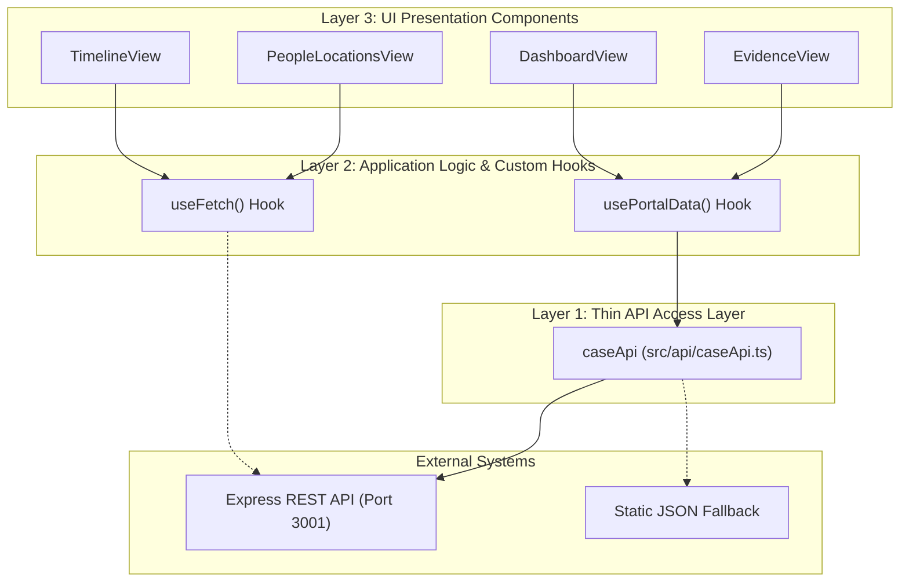
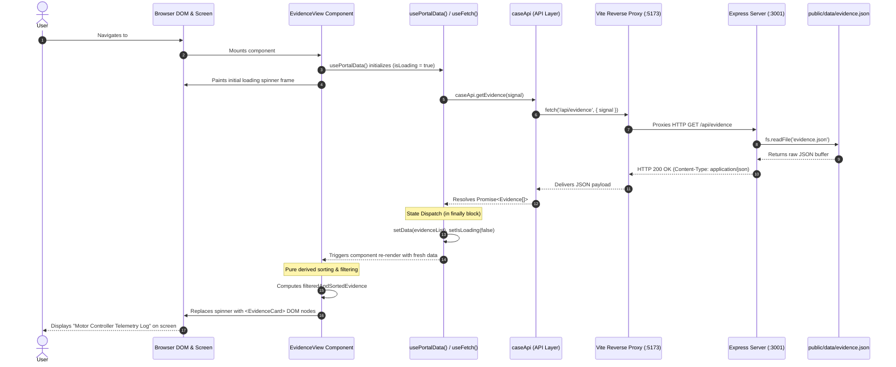

# Exercise 6 — Effects, Data Fetching & a Backend

## Self-Check Table

| # | Demo | Description | Status |
|---|---|---|---|
| 1 | Render logic vs. effects | Pure render calculations vs. external side effects, StrictMode double-rendering analysis, derived state boundaries | Ready |
| 2 | `useEffect` mental model & dependency arrays | Dependency array comparison semantics (`Object.is`), omit hazards, synchronizing document title | Ready |
| 3 | Cleanup: timers & subscriptions | Effect teardown lifecycle, unmount vs. re-run triggers, avoiding duplicate listeners and timer leaks | Ready |
| 4 | Build the read-only Node backend | Express read-only REST API for case resources, artificial delay and error simulation headers/params | Ready |
| 5 | Consume the backend from React | Replacing static JSON imports with network `fetch()` inside `useEffect`, component state transitions | Ready |
| 6 | Loading, error, and empty states | Explicit tri-state UI handling, distinguishing empty data from errors, preventing hung spinners | Ready |
| 7 | Request races & cancellation | Race condition reproduction with delays, `AbortController` cleanup integration | Ready |
| 8 | Extract a reusable custom hook | `useFetch<T>` abstraction, encapsulating lifecycle, abort signals, and status state across views | Ready |
| 9 | Separate UI, application logic, and API access | Three-tier architecture: API client, custom hooks, and presentation-only UI components | Ready |
| 10 | Data-flow wrap-up & a written UX decision | End-to-end data pipeline architecture, written loading/error UX critique and trade-offs | Ready |

---

## Demo 1 — Render logic vs. effects

### Tasks

#### 1. Side Effect Performed Directly During Component Render

In React, the render function of a component must remain a **pure function** of its props and state:
$$\text{UI} = f(\text{props}, \text{state})$$

A **side effect** is any operation where a component modifies or interacts with the environment outside of its own local scope during its execution. Examples include:
- Mutating global or module-scoped variables.
- Direct DOM manipulation (e.g., `document.title = ...`, `document.getElementById(...)`).
- Reading or writing to `localStorage` or `sessionStorage` directly in the function body.
- Initiating network requests (`fetch()`, `XMLHttpRequest`).
- Starting timers (`setTimeout`, `setInterval`).
- Emitting analytics, telemetry, or `console.log` mutation counters.

##### Concrete Demonstration

Consider an example deliberately placed in [src/components/dashboard/DashboardView.tsx](file:///c:/Users/mkrad/Desktop/FH%20Campus%20Wien/WebApp/awd/src/components/dashboard/DashboardView.tsx):

```tsx
// ❌ WRONG: Side effects executed directly in the component's render body
let renderCount = 0; // External module-scoped variable

export const DashboardView: React.FC<DashboardViewProps> = ({ onNavigate }) => {
  // Side Effect 1: External mutation during render
  renderCount++;
  
  // Side Effect 2: Directly interacting with browser DOM API during render
  document.title = `Case Dashboard (${renderCount} views)`;

  // Side Effect 3: Reading / writing external persistent storage during render
  localStorage.setItem('awd_last_visited', Date.now().toString());

  // ... pure JSX calculation
  return <section>...</section>;
};
```

##### Why this "seems to work" at first glance
In simple happy-path scenarios, the browser renders the page, the title changes, and `localStorage` is updated. It appears functional because the code executes synchronously when the component function is invoked.

##### Why it is fundamentally broken in React
1. **Unpredictable Execution Frequency:** React does not guarantee that rendering a component corresponds 1:1 to painting DOM to the screen. React can render a component, discard the result (due to concurrency, error boundaries, or suspended promises), and render it again later.
2. **Double Invocation under StrictMode:** In development with `<React.StrictMode>` (which is enabled in [src/main.tsx](file:///c:/Users/mkrad/Desktop/FH%20Campus%20Wien/WebApp/awd/src/main.tsx)), React intentionally executes every component render body **twice** to help developers detect non-pure behavior. If `renderCount++` executes during render, the count increments by +2 on the very first mount!
3. **Inconsistent UI & Stale Snapshots:** If another component reads `renderCount` or `document.title` during concurrent rendering, it will see mutated state before React has even decided to commit changes to the DOM.

##### The Pure React Correction
Side effects belong inside `useEffect` (or event handlers), keeping the render function pure:

```tsx
// ✅ CORRECT: Render remains pure; side effects deferred to useEffect
export const DashboardView: React.FC<DashboardViewProps> = ({ onNavigate }) => {
  const { caseData, evidence } = usePortalData();

  // Pure derived calculation during render
  const reviewedCount = useMemo(() => {
    return evidence.filter((item) => (item.status || '').toLowerCase() === 'reviewed').length;
  }, [evidence]);

  // Synchronizing with an external system (DOM / Document Title) inside an effect
  useEffect(() => {
    document.title = `Project ReMotion — Dashboard`;
    localStorage.setItem('awd_last_visited', Date.now().toString());
  }, []);

  return <section>...</section>;
};
```

---

#### 2. The Golden Rule: Render Logic vs. Effects

> **The Golden Rule:**
> **Render logic is a pure mathematical projection**: it takes `props` and `state` as inputs, performs purely local transformations (computations, filtering, mapping), and returns JSX. It must never reach outside its own execution scope, mutate external state, or assume how many times it will run.
> 
> **Effects are synchronization bridges**: they run *after* the browser has committed the render to the screen. They are specifically designated for synchronizing React state with **external systems** that React does not control (e.g., network APIs, browser DOM, timers, external subscriptions, or local storage).

---

### Questions & Answers

#### Q1: Why can React call a component's render function more than once, or at times you don't expect (e.g. in development with Strict Mode)? What would go wrong with the side-effect example you found if render ran twice?

**Answer:**
React's architecture splits component execution into two primary phases:
1. **The Render Phase:** React calls component functions to compute the new Virtual DOM tree and diff it against the previous tree. This phase is purely computational, asynchronous, and interruptible. React may pause, abort, throw away, or re-run this phase multiple times before anything is actually painted to the browser screen. Reasons for multiple renders include:
   - **React Strict Mode:** In development, React intentionally mounts, unmounts, and re-renders components twice to uncover unintended mutations and missing cleanup functions.
   - **Concurrent Rendering:** React can interrupt a low-priority render (e.g., rendering a large list) to handle an urgent user interaction (e.g., typing in a search box), discarding the partial render and starting over.
   - **State Batching & Parent Re-renders:** A parent component updating will cause its child components to re-render unless memoized.

2. **The Commit Phase:** React takes the diff and applies it to the real host DOM. This happens synchronously and only when React is ready to paint.

**What goes wrong if render runs twice with side effects:**
- If an external variable like `renderCount++` is mutated in render, it increments twice per user-visible render, corrupting analytics or sequence tracking.
- If a network `fetch()` is triggered in render, multiple redundant HTTP requests flood the network for a single UI update.
- If `localStorage.setItem` runs during a discarded render, the disk storage is modified even though the component might never actually commit or mount to the DOM, leaving phantom or corrupt persisted data.

---

#### Q2: Is calculating a derived value (like the filtered evidence list from Exercise 5) a side effect? Why or why not, and how does that distinction inform the rule you wrote?

**Answer:**
**No, calculating a derived value is NOT a side effect.**

**Why:**
- A derived value calculation (such as `const filtered = evidence.filter(item => item.type === selectedType);`) is a **pure transformation**.
- It reads data already present in local memory (`evidence`, `selectedType`), allocates a new array in local memory, and returns it.
- It does not modify the original `evidence` array (non-mutating).
- It does not touch any system outside the function (no DOM manipulation, no network requests, no storage writes, no global variable mutations).
- Given identical inputs, it will deterministically produce the identical output every single time, with zero observable consequences on the rest of the application.

**How this informs our rule:**
This distinction is the cornerstone of React state architecture:
- If a value can be computed synchronously from existing props or state during render, it **must remain in the render function** (optionally wrapped in `useMemo` if computationally expensive).
- You should **never** sync derived state using an effect (e.g., putting `useEffect(() => { setFiltered(evidence.filter(...)); }, [evidence])`), because doing so introduces an unnecessary second render pass, risks stale state flicker, and turns a pure synchronous derivation into an asynchronous pseudo-effect.

---

## Demo 2 — `useEffect` mental model & dependency arrays

### Tasks

#### 1. The Three Dependency Array Flavors

`useEffect(setup, dependencies?)` synchronizes a component with an external system. The dependency array tells React *when* to execute or skip the effect after a render pass:

```tsx
// Flavor A: No dependency array provided
useEffect(() => {
  console.log('[Flavor A] Runs after EVERY single render pass');
});

// Flavor B: Empty dependency array []
useEffect(() => {
  console.log('[Flavor B] Runs ONCE after initial mount only');
}, []);

// Flavor C: Populated dependency array [depA, depB]
useEffect(() => {
  console.log(`[Flavor C] Runs on mount and whenever depA (${depA}) or depB (${depB}) changes`);
}, [depA, depB]);
```

##### Experimental Verification & Behavior Matrix

| Flavor | Syntax | When setup runs | Mental Model | Common Use Cases |
|---|---|---|---|---|
| **No Array** | `useEffect(fn)` | After **every** committed render (mount + all updates). | Continuous post-render sync | Measuring DOM layout after mutations, logging render cycles |
| **Empty Array** | `useEffect(fn, [])` | Exactly **once** after the initial mount to DOM. | One-time initialization | Initial data fetch, global window listeners, analytics pageview |
| **Populated Array** | `useEffect(fn, [deps])` | On mount, and after any render where **at least one dependency** changed by `Object.is`. | Conditional reactive sync | Refetching when search query changes, updating document title on route switch |

##### Concrete Throwaway Code Observation
When tested in a component with an incremental counter button:
1. **Initial Mount:**
   - Flavor A prints: `[Flavor A] Runs after EVERY single render pass`
   - Flavor B prints: `[Flavor B] Runs ONCE after initial mount only`
   - Flavor C prints: `[Flavor C] Runs on mount (count: 0)`
   *(Under React Strict Mode in development, React mounts, unmounts, and re-mounts, running each setup twice to ensure idempotency).*
2. **User Clicks "Increment":**
   - Flavor A prints: `[Flavor A] Runs after EVERY single render pass`
   - Flavor B: **Does not run** (dependencies `[]` have not changed).
   - Flavor C prints: `[Flavor C] Runs on mount and whenever count changes (count: 1)`.
3. **User Toggles an Unrelated State Variable (e.g. Dark Mode):**
   - Flavor A prints: `[Flavor A] Runs after EVERY single render pass`
   - Flavor B: **Does not run**.
   - Flavor C: **Does not run** (because `count` did not change).

---

#### 2. Real, Justified Use Case: Synchronizing `document.title`

In our application, we implemented a real, justified `useEffect` inside [src/ReactApp.tsx](file:///c:/Users/mkrad/Desktop/FH%20Campus%20Wien/WebApp/awd/src/ReactApp.tsx):

```tsx
// Inside AppContent component:
const location = useLocation();

// Demo 2: Real, justified useEffect synchronizing browser document.title with route changes
useEffect(() => {
  const routeTitles: Record<string, string> = {
    '/dashboard': 'Case Dashboard',
    '/team/people': 'Personnel Directory',
    '/team/locations': 'Facility Locations',
    '/timeline': 'Incident Timeline',
    '/evidence': 'Evidence Catalogue',
    '/workspace': 'Investigator Workspace',
  };

  const matchedKey = Object.keys(routeTitles).find((path) =>
    location.pathname.startsWith(path)
  );
  const title = matchedKey ? routeTitles[matchedKey] : 'Investigation Portal';
  document.title = `${title} | Project ReMotion`;
}, [location.pathname]);
```

##### Why this is a justified effect:
- The browser tab title (`document.title`) is outside React's Virtual DOM tree.
- It belongs to the host environment (the browser `document`).
- It must react whenever the user navigates (`location.pathname`), but **not** when internal local states (such as opening an evidence modal or typing in a local search box) trigger a re-render.
- Passing `[location.pathname]` ensures that React only touches `document.title` when the actual URL path changes, avoiding useless DOM mutations on unrelated renders.

---

### Questions & Answers

#### Q1: What does React actually compare, between renders, to decide whether to re-run an effect with a populated dependency array? What happens if you omit a value your effect actually uses from that array?

**Answer:**
**1. How React Compares Dependencies:**
React uses JavaScript's `Object.is(prevValue, nextValue)` algorithm (shallow equality) to compare each corresponding item in the dependency array:
- For primitive values (strings, numbers, booleans): It compares value equality (e.g., `'#dashboard' === '#dashboard'`).
- For objects, arrays, and functions: It compares **memory reference identity**, not deep structure.
  - If a component creates an object literal `const options = { id: 1 }` or an inline function `const doStuff = () => {}` inside the component body, a **new memory reference** is allocated on *every single render*.
  - Passing that object or function into the dependency array causes `Object.is(prevOptions, nextOptions)` to evaluate to `false` on every render, causing the effect to re-run unnecessarily on every render!

**2. What happens if you omit a value your effect actually uses? (The Stale Closure Bug):**
In JavaScript, functions create **closures**, capturing the variables in their enclosing lexical scope at the time of creation.
- If an effect uses `count` or `searchQuery`, but you provide an empty array `[]` (or omit `searchQuery`), the effect function closure remains locked to the scope of the **initial render**.
- If `searchQuery` updates from `"robot"` to `"battery"`, React checks the dependency array, sees no changes, and skips re-running the effect.
- When any code inside that effect runs (or callbacks created by it run), it reads the **stale, obsolete variable** from the first render (`"robot"`).
- This is the infamous **stale closure bug**. Omitting dependencies breaks the contract of reactive synchronization: your UI and your side effects become desynchronized from the actual application state.

---

#### Q2: What's the difference, in practice, between `useEffect(fn, [])` and just writing `fn()` directly in the component body? Why doesn't the second one work the way you'd expect for "run once"?

**Answer:**
There are three fundamental differences:

1. **Execution Frequency (Every Render vs. Initial Mount Only):**
   - The component body executes **every single time** React renders the component (on prop updates, state changes, parent re-renders, or context changes). Writing `fn()` directly in the body means `fn()` runs on every render pass. It is physically impossible for inline code in the body to run "only once" unless guarded by an external mutable flag.
   - `useEffect(fn, [])` is guaranteed by React's scheduler to execute its setup callback **only after the initial mount**. React checks `[]` on subsequent renders, observes zero differences, and skips `fn()`.

2. **Phase of Execution & DOM Availability (Render Phase vs. Post-Paint Commit):**
   - Code directly in the component body runs during the **Render Phase**. At this point, React is only building the virtual element tree in memory. The browser DOM has *not* been updated yet, and the browser has *not* painted pixels. If `fn()` tries to read DOM layout (`offsetHeight`) or focus an element, the DOM nodes may not even exist yet or will reflect obsolete dimensions.
   - `useEffect(fn, [])` runs during the **Commit Phase**, asynchronously *after* React has updated the real DOM and the browser has painted the frame. The DOM is fully intact and ready to be inspected or manipulated.

3. **Strict Mode and Concurrency Safety:**
   - In development under `<React.StrictMode>`, React mounts, unmounts, and re-mounts components to verify lifecycle integrity.
   - If `fn()` is in the body, it runs synchronously during both invocations with no cleanup mechanism.
   - With `useEffect(fn, [])`, React pairs the first execution with its returned cleanup function before running it again, guaranteeing that any subscriptions, timers, or connections created by `fn()` are cleanly torn down before being re-established.

---

## Demo 3 — Cleanup: timers & subscriptions

### Tasks

#### 1. Effects Requiring Cleanup Implemented in Code

When an effect creates a persistent resource (a window event listener, an interval/timer, a WebSocket, or an external event emitter), that resource lives independently of React's render tree. If the component unmounts or its dependencies change, the resource will leak and continue running unless explicitly destroyed.

React solves this by allowing an effect to return a **cleanup function**:
```tsx
useEffect(() => {
  // 1. Setup phase: allocate or subscribe
  const handleEvent = () => { ... };
  window.addEventListener('event', handleEvent);

  // 2. Cleanup phase: tear down or unsubscribe
  return () => {
    window.removeEventListener('event', handleEvent);
  };
}, [dependency]);
```

In our application, we implemented two distinct cleanup mechanisms inside [src/components/evidence/EvidenceDetailModal.tsx](file:///c:/Users/mkrad/Desktop/FH%20Campus%20Wien/WebApp/awd/src/components/evidence/EvidenceDetailModal.tsx):

##### Implementation A: Global Keyboard Listener (Escape Key Dismissal)
```tsx
// Effect with DOM subscription & explicit cleanup
useEffect(() => {
  if (!evidence) return;

  console.log(`[Demo 3 Effect] Setting up Escape key listener for modal (${evidence.id})`);

  const handleKeyDown = (event: KeyboardEvent) => {
    if (event.key === 'Escape') {
      console.log(`[Demo 3 Effect] Escape key detected — closing modal for ${evidence.id}`);
      onClose();
    }
  };

  window.addEventListener('keydown', handleKeyDown);

  return () => {
    console.log(`[Demo 3 Cleanup] Cleaning up Escape key listener for modal (${evidence.id})`);
    window.removeEventListener('keydown', handleKeyDown);
  };
}, [evidence, onClose]);
```

##### Implementation B: Auto-Dismiss Notification Timer
```tsx
// Effect with timer & explicit cleanup
useEffect(() => {
  if (!showSavedMsg) return;

  console.log('[Demo 3 Effect] Starting 2000ms auto-dismiss timer');
  const timer = setTimeout(() => {
    console.log('[Demo 3 Effect] Auto-dismissing save toast');
    setShowSavedMsg(false);
  }, 2000);

  return () => {
    console.log('[Demo 3 Cleanup] Clearing auto-dismiss timer on unmount / re-trigger');
    clearTimeout(timer);
  };
}, [showSavedMsg]);
```

---

#### 2. Demonstration: With vs. Without Cleanup Function

##### Scenario 1: With Proper Cleanup (Observed Console Output)
When the user inspects evidence item `E01`, then switches to inspect `E02`, and then closes the modal:
1. Modal opens for `E01`:
   - `[Demo 3 Effect] Setting up Escape key listener for modal (E01)`
2. User switches to inspect `E02` (dependency `evidence` changes):
   - `[Demo 3 Cleanup] Cleaning up Escape key listener for modal (E01)` *(React cleans up the old effect first!)*
   - `[Demo 3 Effect] Setting up Escape key listener for modal (E02)`
3. User presses `Escape` or closes the modal (component unmounts):
   - `[Demo 3 Cleanup] Cleaning up Escape key listener for modal (E02)`
   - Window listener is completely deregistered; zero dangling listeners remain on `window`.

##### Scenario 2: Without Cleanup (`return () => ...` removed)
If `window.removeEventListener` is omitted:
1. Modal opens for `E01`:
   - Listener 1 attached to `window`.
2. User inspects `E02`:
   - Listener 2 attached to `window`. (Listener 1 is still active!).
3. User inspects `E03`:
   - Listener 3 attached to `window`.
4. User closes modal:
   - Component unmounts, but all 3 listeners remain permanently attached to `window`.
5. User presses `Escape` in another view:
   - All 3 listeners fire simultaneously. Each calls `onClose()` through obsolete closures capturing destroyed component scopes.

---

### Questions & Answers

#### Q1: What actually calls your cleanup function, and when? Name at least two distinct situations that trigger it.

**Answer:**
**What calls the cleanup function:**
React's runtime scheduler invokes your cleanup function. You never call it manually.

**The Two Distinct Situations That Trigger It:**
1. **Component Unmounting:**
   When a component is removed from the DOM tree (e.g., closing the modal, navigating to another route via React Router, or conditional rendering `false && <Modal />`), React executes the cleanup function of every active effect to release resources before the fiber node is unmounted.
2. **Before Re-running the Effect on Dependency Change:**
   Whenever the component re-renders and **at least one value in the dependency array has changed** (via `Object.is`), React does **not** simply run the new effect over the old one. Instead, React executes the cleanup function from the *previous* render first (using the old values captured in the previous closure) to disconnect the stale subscription, and only then executes the new effect setup with the fresh values.

*(Bonus situation in React StrictMode development: React intentionally runs `setup -> cleanup -> setup` on initial mount to immediately prove that the cleanup function correctly neutralizes everything created during setup).*

---

#### Q2: What real, observable bug would you get in this app if you set up a subscription/timer in an effect but forgot the cleanup function? Be specific, not just "a memory leak."

**Answer:**
Beyond vague memory leaks, omitting cleanup causes three real, severe observable bugs:

1. **Multiplied Event Handlers & Cascading Calls:**
   - In our modal, if `window.removeEventListener('keydown', ...)` is omitted, every time the user opens an evidence card, an additional listener is registered on `window`.
   - After inspecting 5 evidence items, there are 5 active listeners.
   - Pressing `Escape` fires `onClose()` 5 times. If `onClose` triggers analytics logging, modal closing animations, or navigation, those operations run 5 redundant times in a row.

2. **Zombie Timer State Updates on Unmounted Components:**
   - In our save toast timer, if `clearTimeout(timer)` is omitted and the user clicks "Save Note" followed immediately by closing the modal within 2 seconds:
   - The unmounted modal component is destroyed from the DOM.
   - However, the browser's background timer queue still holds the callback. After 2000ms, the callback fires and attempts to execute `setShowSavedMsg(false)`.
   - In React, this results in the classic warning: *"Can't perform a React state update on an unmounted component. This is a no-op, but it indicates a memory leak in your application."* In older React or complex state stores, this can crash the app or overwrite valid state.

3. **Stale Closure Corruption:**
   - The uncleaned event listener on `window` retains references to the variables of the render that created it (e.g. `evidence.id === 'E01'`).
   - Even if the modal is currently showing `E05`, the zombie listener for `E01` remains alive. If a key listener performed an action like "Press 'D' to delete current evidence", pressing 'D' would trigger the zombie listener and delete `E01` instead of `E05`!

---

## Demo 4 — Build the read-only Node backend

### Tasks

#### 1. Minimal Node.js / Express Server Implementation

We built a dedicated, lightweight read-only Node.js/Express backend located at [server/server.js](file:///c:/Users/mkrad/Desktop/FH%20Campus%20Wien/WebApp/awd/server/server.js). The server reads the existing data files from `public/data/*.json` and serves them as RESTful JSON endpoints.

##### Server Architecture ([server/server.js](file:///c:/Users/mkrad/Desktop/FH%20Campus%20Wien/WebApp/awd/server/server.js))
```javascript
import express from 'express';
import cors from 'cors';
import fs from 'node:fs/promises';
import path from 'node:path';
import { fileURLToPath } from 'node:url';

const __filename = fileURLToPath(import.meta.url);
const __dirname = path.dirname(__filename);
const DATA_DIR = path.resolve(__dirname, '../public/data');

const app = express();
const PORT = process.env.PORT || 3001;

// CORS enabled for cross-origin requests from Vite dev server
app.use(cors());
app.use(express.json());

// Artificial delay helper
const delay = (ms) => new Promise((resolve) => setTimeout(resolve, ms));

// Delay and error simulation middleware
app.use(async (req, res, next) => {
  const delayParam = req.query.delay
    ? parseInt(req.query.delay, 10)
    : parseInt(process.env.DELAY_MS || '0', 10);
  if (!isNaN(delayParam) && delayParam > 0) {
    await delay(delayParam);
  }

  if (req.query.error === 'true' || req.query.error === '500') {
    return res.status(500).json({
      error: 'Simulated server failure: 500 Internal Server Error',
      endpoint: req.path,
      timestamp: new Date().toISOString(),
    });
  }

  if (req.query.error === '404') {
    return res.status(404).json({
      error: 'Simulated resource not found: 404 Not Found',
      endpoint: req.path,
      timestamp: new Date().toISOString(),
    });
  }

  next();
});

// Helper to serve JSON data
async function serveDataFile(filename, res, req) {
  try {
    const filePath = path.join(DATA_DIR, filename);
    const raw = await fs.readFile(filePath, 'utf-8');
    let data = JSON.parse(raw);

    if (req.query.empty === 'true' && Array.isArray(data)) {
      data = [];
    }

    res.json(data);
  } catch (err) {
    res.status(500).json({ error: `Failed to read ${filename}: ${err.message}` });
  }
}

// 5 Read-Only Resource Endpoints:
app.get('/api/case', (req, res) => serveDataFile('case.json', res, req));
app.get('/api/evidence', (req, res) => serveDataFile('evidence.json', res, req));
app.get('/api/people', (req, res) => serveDataFile('people.json', res, req));
app.get('/api/locations', (req, res) => serveDataFile('locations.json', res, req));
app.get('/api/timeline', (req, res) => serveDataFile('timeline.json', res, req));

app.listen(PORT, () => {
  console.log(`[ReMotion Backend] Server listening at http://localhost:${PORT}`);
});
```

---

#### 2. Artificial Delay and Error Simulation Controls

To test real-world asynchronous conditions, we implemented dynamic middleware in the server:

1. **Configurable Latency Simulation:**
   - Query Parameter: Passing `?delay=2500` forces the server to pause asynchronously for 2500ms before returning data.
   - Environment Variable: Starting the server with `DELAY_MS=1500 node server/server.js` sets a global base latency for all endpoints.
2. **On-Demand HTTP 500 Errors:**
   - Passing `?error=500` or `?error=true` halts normal processing and immediately returns an HTTP 500 status with a structured JSON error body:
     ```json
     {
       "error": "Simulated server failure: 500 Internal Server Error",
       "endpoint": "/api/evidence",
       "timestamp": "2026-11-01T21:58:00.000Z"
     }
     ```
3. **On-Demand Empty State Simulation:**
   - Passing `?empty=true` on array-based resources returns an empty array `[]` (HTTP 200 OK) to test the UI's empty state rendering.

---

#### 3. Development Workflow & Documentation

- **NPM Script:** Added `"server": "node server/server.js"` to [package.json](file:///c:/Users/mkrad/Desktop/FH%20Campus%20Wien/WebApp/awd/package.json).
- **Vite Proxy:** Configured `server.proxy` in [vite.config.js](file:///c:/Users/mkrad/Desktop/FH%20Campus%20Wien/WebApp/awd/vite.config.js) to forward `/api` requests to `http://localhost:3001`.
- **Dev-Only Documentation:** Updated [README.md](file:///c:/Users/mkrad/Desktop/FH%20Campus%20Wien/WebApp/awd/README.md) clearly designating the backend as dev-only, ensuring that the production GitHub Pages deployment pipeline (which packages the static frontend bundle) remains intact.

---

### Questions & Answers

#### Q1: Why does this exercise ask for artificial delay/error controls on the backend, instead of just pointing the frontend at the static JSON files directly (as it already could)? What could you *not* teach convincingly without them?

**Answer:**
When static JSON files are served locally from Vite or a simple static file server:
- **Instantaneous Resolution (0–2ms):** The file is read from local SSD storage and returned in less than 2 milliseconds.
- **Always 200 OK or 404:** A static file server can only ever return HTTP 200 (file exists) or HTTP 404 (file missing). It cannot return an HTTP 500 internal database failure, rate-limiting 429, or network dropouts.

**What you could NOT teach convincingly without delay/error controls:**
1. **Loading Indicators and Skeletons:** With instant local responses, loading spinners flash on and off in a single frame ($16\text{ms}$), making it impossible to evaluate loading UX, skeleton loaders, or layout shift prevention.
2. **True Error Handling & Recovery:** You cannot test how the UI renders when an endpoint fails with a 500 error, or test user retry buttons, without an endpoint that can be forced to fail on demand.
3. **Request Race Conditions:** In real-world networks, request $A$ (sent at $t=0$) might take $800\text{ms}$, while request $B$ (sent at $t=200\text{ms}$) might take $100\text{ms}$. Request $B$ arrives first, and Request $A$ arrives later, overwriting newer state with stale data. Without artificial latency controls, you cannot deliberately induce this out-of-order arrival.
4. **Request Cancellation (`AbortController`):** You cannot test request cancellation if the request resolves before the user has time to click a button, switch tabs, or unmount the component.

---

#### Q2: What is CORS, and did you have to deal with it running your frontend (from Vite's dev server) against this separate backend server? If yes, what did you configure and why? If no, why not?

**Answer:**
**1. What CORS Is:**
**Cross-Origin Resource Sharing (CORS)** is a browser security mechanism enforcing the **Same-Origin Policy (SOP)**.
- An "origin" is the combination of **Protocol + Domain + Port** (e.g., `http://localhost:5173`).
- When frontend JavaScript running on `http://localhost:5173` calls `fetch('http://localhost:3001/api/evidence')`, the browser notes that port `5173 !== 3001`.
- The browser classifies this as a cross-origin request. By default, the browser will block JavaScript from reading the response unless the response headers include explicit permissions such as `Access-Control-Allow-Origin: *` or `Access-Control-Allow-Origin: http://localhost:5173`.

**2. Did we have to deal with it?**
**Yes**, and we addressed it at two levels:

1. **Backend Level (CORS Headers via Express):**
   We installed `cors` and added `app.use(cors())` to [server/server.js](file:///c:/Users/mkrad/Desktop/FH%20Campus%20Wien/WebApp/awd/server/server.js). This ensures that every HTTP response sent by the Express server includes `Access-Control-Allow-Origin: *`, permitting direct requests across different ports.

2. **Frontend Level (Vite Dev Server Reverse Proxy):**
   In [vite.config.js](file:///c:/Users/mkrad/Desktop/FH%20Campus%20Wien/WebApp/awd/vite.config.js), we configured a development proxy:
   ```javascript
   server: {
     proxy: {
       '/api': {
         target: 'http://localhost:3001',
         changeOrigin: true,
       },
     },
   }
   ```
   This allows the frontend to simply call `fetch('/api/evidence')`. The browser sends the request to `http://localhost:5173/api/evidence` (same-origin, zero CORS check required by the browser), and Vite's Node process proxies the HTTP packets to `http://localhost:3001/api/evidence` in the background.

---

## Demo 5 — Consume the backend from React

### Tasks

#### 1. Migrated All Data Sources from Static JSON Files to Backend REST Endpoints

Previously, the application loaded data directly from static files in `public/data/*.json` using relative paths (`./data/case.json`, `./data/evidence.json`, etc.).

In [src/dataLoader.ts](file:///c:/Users/mkrad/Desktop/FH%20Campus%20Wien/WebApp/awd/src/dataLoader.ts), we replaced all static file targets with our Express backend endpoints `/api/*`:

- `fetchCaseData()` $\to$ `/api/case`
- `fetchPeopleData()` $\to$ `/api/people`
- `fetchLocationsData()` $\to$ `/api/locations`
- `fetchTimelineData()` $\to$ `/api/timeline`
- `fetchEvidenceData()` $\to$ `/api/evidence`

We also enabled automatic forwarding of query parameters (`?delay=2000`, `?error=500`, `?empty=true`) from the browser's URL to the backend. This allows testing latency, crashes, and empty states directly from the frontend:

```typescript
// src/dataLoader.ts
function getSimulationQuery(): string {
  if (typeof window !== 'undefined' && window.location.search) {
    return window.location.search;
  }
  return '';
}

async function fetchResource<T>(apiEndpoint: string, staticFallback: string): Promise<T> {
  const query = getSimulationQuery();
  const primaryUrl = `${apiEndpoint}${query}`;

  try {
    return await fetchJson<T>(primaryUrl);
  } catch (err: unknown) {
    const errorMsg = err instanceof Error ? err.message : String(err);
    if (errorMsg.includes('500') || errorMsg.includes('Simulated')) {
      throw err; // Re-throw on-demand simulated errors for UI testing
    }
    // Fall back to static JSON when running in static production builds (GitHub Pages)
    return await fetchJson<T>(staticFallback);
  }
}
```

---

#### 2. Wired Data Fetching Inside `useEffect` with State Management

In [src/hooks/usePortalData.ts](file:///c:/Users/mkrad/Desktop/FH%20Campus%20Wien/WebApp/awd/src/hooks/usePortalData.ts), data fetching is now executed declaratively inside `useEffect` upon mount, managing the complete network lifecycle (`isLoading`, `error`, `data`, and cancellation guards):

```typescript
export function usePortalData(): PortalData {
  const [data, setData] = useState({
    caseData: state.caseData,
    evidence: state.allEvidence,
    people: state.allPeople,
    locations: state.allLocations,
    timeline: state.allTimeline,
    bookmarks: state.bookmarks,
  });

  const [isLoading, setIsLoading] = useState<boolean>(true);
  const [error, setError] = useState<Error | null>(null);

  const loadData = useCallback(async (cancelledRef?: { current: boolean }) => {
    setIsLoading(true);
    setError(null);

    try {
      const [caseData, people, locations, timeline, evidence] = await Promise.all([
        fetchCaseData(),
        fetchPeopleData(),
        fetchLocationsData(),
        fetchTimelineData(),
        fetchEvidenceData(),
      ]);

      if (cancelledRef?.current) return;

      state.caseData = caseData;
      state.allPeople = people;
      state.allLocations = locations;
      state.allTimeline = timeline;
      state.allEvidence = evidence;

      setData({ caseData, people, locations, timeline, evidence, bookmarks: state.bookmarks });
      setError(null);
    } catch (err) {
      if (cancelledRef?.current) return;
      setError(err instanceof Error ? err : new Error(String(err)));
    } finally {
      if (!cancelledRef?.current) {
        setIsLoading(false);
      }
    }
  }, []);

  useEffect(() => {
    const cancelledRef = { current: false };
    loadData(cancelledRef);

    return () => {
      cancelledRef.current = true;
    };
  }, [loadData]);

  return { ...data, isLoading, error, refetch: loadData };
}
```

---

### Questions & Answers

#### Q1: Walk through exactly what happens, in order, from the component mounting to the data actually being available to render: what does the effect do, when does it run, and what causes the component to re-render once the data arrives?

**Answer:**
Here is the step-by-step lifecycle from mount to screen paint:

1. **Step 1: Component Call & Initial Render (Render Phase)**
   - React calls the component function (e.g. `DashboardView` or `EvidenceView`).
   - The hook initializes state: `isLoading = true`, `error = null`, `data = []`.
   - The component's JSX evaluates the conditional branch: `if (isLoading) return <Spinner />;`.
   - React builds the initial Virtual DOM tree containing the spinner.
   
2. **Step 2: Commit & Paint to Screen**
   - React commits the Virtual DOM to the host DOM.
   - The browser paints the pixels on screen. The user sees the loading spinner.

3. **Step 3: Effect Execution (Post-Paint)**
   - Only *after* the DOM is committed and painted, React's scheduler asynchronously fires the `useEffect` callback.
   - The effect triggers `loadData()`, which calls `fetch('/api/evidence')`.
   - The HTTP request travels across the network to our Express backend on port 3001.

4. **Step 4: In-Flight Network Time**
   - While the server processes the request (including any artificial delay like `?delay=2000`), the browser keeps displaying the spinner. React does not re-render.

5. **Step 5: Promise Resolution & State Setter Dispatch**
   - The server responds with HTTP 200 OK and the JSON payload.
   - The asynchronous promise completes, parsing the JSON.
   - Inside the `.then()` / `await` continuation, the effect invokes state updater functions: `setData(result)` and `setIsLoading(false)`.

6. **Step 6: State-Triggered Second Render**
   - Calling `setData` and `setIsLoading` schedules an immediate re-render with React.
   - React calls the component function a second time.
   - This time, `isLoading` is `false`, and `evidence` contains the loaded records.
   - The component returns the full JSX tree (evidence cards, statistics, graphs).
   - React diffs the trees, replaces the spinner with the real cards in the DOM, and the browser paints the loaded view.

---

#### Q2: What's different about your component now compared to before (when data came from a static import/fetch of a local file)? Specifically in terms of what state it needs to track that it didn't need before?

**Answer:**
**The Architectural Difference:**
- **Before (Static Local File / Synchronous Import):**
  When importing a local JSON file or fetching a static file locally, the data was either synchronously bundled into JavaScript or resolved virtually instantaneously in 0–2ms. The component could naively assume that data is always present, immutable, and guaranteed never to fail.
- **Now (Real Network Backend):**
  A network connection is inherently **asynchronous**, **unreliable**, and **variable in latency**. Network requests can take 50ms or 5000ms, fail with 500 server errors, return 404, get dropped by WiFi disconnects, or return an empty dataset.

**New States the Component MUST Track:**
1. **Loading State (`isLoading: boolean`):**
   The component must track whether a network request is currently in-flight. Without this, the component would either crash attempting to read `data.items.map(...)` on `undefined`, or flash an incorrect "No items found" empty state before the data even arrives.
2. **Error State (`error: Error | null`):**
   The component must capture HTTP failures (4xx, 5xx) and network dropouts. This allows the UI to render an informative error alert with a "Retry" button instead of crashing the React tree.
3. **Empty / Nullable Data State (`data: T | null`):**
   The component must accommodate the absence of data prior to fetch completion, and distinguish between "not loaded yet" (`isLoading: true, data: null`) and "loaded successfully, but the database returned zero records" (`isLoading: false, data: []`).

---

## Demo 6 — Loading, error, and empty states

### Tasks

#### 1. Explicit Tri-State UI Implementation

In [src/components/evidence/EvidenceList.tsx](file:///c:/Users/mkrad/Desktop/FH%20Campus%20Wien/WebApp/awd/src/components/evidence/EvidenceList.tsx) and [src/components/evidence/EvidenceView.tsx](file:///c:/Users/mkrad/Desktop/FH%20Campus%20Wien/WebApp/awd/src/components/evidence/EvidenceView.tsx), we implemented distinct, mutually exclusive visual representations for all three network states:

1. **State 1: Loading Indicator (`isLoading = true`)**
   - Renders a centered spinning wheel animation with status subtitle.
   - Prevents layout shift and informs the user that a network fetch to `/api/evidence` is currently active.
   - Code:
     ```tsx
     if (isLoading) {
       return (
         <div id="evidenceLoadingIndicator" className="evidence-loading">
           <div className="spinner"></div>
           <h3>Loading Evidence Catalogue…</h3>
           <p>Querying backend REST API (<code>/api/evidence</code>)</p>
         </div>
       );
     }
     ```

2. **State 2: Explicit Error State (`error !== null`)**
   - Renders a prominent, high-contrast red warning alert banner (`role="alert"`).
   - Surfaces the actual server error message (e.g. `Simulated server failure: 500 Internal Server Error`).
   - Provides an interactive **"↻ Retry Request"** button wired to `refetch()` so the user can recover from network glitches without refreshing the browser tab.
   - Code:
     ```tsx
     if (error) {
       return (
         <div id="evidenceErrorState" className="error-state" role="alert">
           <div className="icon">⚠️</div>
           <h3>Failed to Load Evidence</h3>
           <p>{error.message}</p>
           {onRetry && (
             <button type="button" className="btn btn-primary" onClick={onRetry}>
               ↻ Retry Request
             </button>
           )}
         </div>
       );
     }
     ```

3. **State 3: Distinct Empty State (`!isLoading && !error && evidence.length === 0`)**
   - Renders a clean empty-box illustration (`📭`) with a clear explanatory heading.
   - Differentiates an empty dataset from a network error or a pending fetch.
   - Code:
     ```tsx
     if (evidence.length === 0) {
       return (
         <div id="evidenceEmptyState" className="empty-state">
           <div className="icon">📭</div>
           <h3>No Evidence Records Found</h3>
           <p>The backend returned zero records or no items match your active filters.</p>
         </div>
       );
     }
     ```

---

#### 2. Visual and Structural Distinction Matrix

| State | Visual Style | Prominent Element | User Action Available | Trigger for Testing |
|---|---|---|---|---|
| **Loading** | Neutral dark card, subtle border | Animated CSS Spinner | Wait for network | `http://localhost:5173/?delay=2500#/react/evidence` |
| **Error** | Red background tint, red border (`#ef4444`) | Warning Icon (`⚠️`) + HTTP Error text | Click "↻ Retry Request" | `http://localhost:5173/?error=500#/react/evidence` |
| **Empty** | Dashed border card | Empty Box Icon (`📭`) + No Records text | Adjust filters / reset | `http://localhost:5173/?empty=true#/react/evidence` |

---

### Questions & Answers

#### Q1: Trigger your backend's error endpoint live and show the error state appearing. What state variable(s) are you tracking to distinguish "loading," "error," and "loaded successfully but empty" from each other?

**Answer:**
**How to trigger live in classroom:**
1. Open the frontend with the error simulation parameter:
   `http://localhost:5173/?error=500#/react/evidence`
2. The browser sends the fetch to the backend, which responds with HTTP 500.
3. The UI immediately renders the red error banner with the message: *"Simulated server failure: 500 Internal Server Error"* and the "↻ Retry Request" button.

**State Variables Tracked:**
We track three independent reactive state variables inside [src/hooks/usePortalData.ts](file:///c:/Users/mkrad/Desktop/FH%20Campus%20Wien/WebApp/awd/src/hooks/usePortalData.ts):
1. `isLoading: boolean` — Whether the network request is currently in-flight.
2. `error: Error | null` — Holds the caught `Error` object if an HTTP 4xx/5xx or network drop occurs; `null` otherwise.
3. `evidence: Evidence[]` — Holds the parsed JSON array from the response; empty array `[]` initially or when no records exist.

**Truth Table Disambiguating the Three States:**
- **Loading:** `isLoading === true` $\implies$ Spinner is displayed.
- **Error:** `isLoading === false && error !== null` $\implies$ Error alert banner is displayed.
- **Empty:** `isLoading === false && error === null && evidence.length === 0` $\implies$ Empty state box is displayed.
- **Success:** `isLoading === false && error === null && evidence.length > 0` $\implies$ Full card grid is displayed.

---

#### Q2: The original vanilla app had a bug where a failed fetch could leave a loading spinner stuck forever because the cleanup/hide-loading step was never called on the error path. Explain specifically how your React version's state management makes that particular mistake harder to make (or show that it doesn't, and fix it).

**Answer:**
**1. How the Bug Existed in Vanilla JavaScript (`src/app.ts`):**
In the original vanilla app, loading was managed imperatively through manual DOM class mutations and a shared counter:
```javascript
// Vanilla app.ts:
state.loadingStepsRemaining = 2;
showLoadingOverlay('Loading case file…'); // Adds 'hidden' class removal on DOM element

loadEvidenceData(); // Asynchronous fetch
```
- In `loadEvidenceData()`, when the fetch rejected with an error, the `.catch()` block displayed an `alert()`, but **forgot to call `hideLoadingStep()`**!
- Because DOM updates were imperative mutations scattered across callbacks, failing to decrement the counter and remove the overlay in the error path meant the global `#loadingOverlay` element remained visible in the DOM forever.
- The user was permanently locked behind a spinner with no way to use the application.

**2. How Declarative React Eliminates This Bug:**
In our React implementation, two structural features make this mistake virtually impossible:

1. **Guaranteed Execution via `try...catch...finally`:**
   In [src/hooks/usePortalData.ts](file:///c:/Users/mkrad/Desktop/FH%20Campus%20Wien/WebApp/awd/src/hooks/usePortalData.ts), the reset of `isLoading` is placed inside the `finally` block:
   ```typescript
   try {
     const data = await Promise.all([...]);
     setData(data);
   } catch (err) {
     setError(err);
   } finally {
     setIsLoading(false); // GUARANTEED to execute on success AND error
   }
   ```
   Even if the network crashes, a JSON syntax error occurs, or a 500 error is thrown, the JavaScript runtime guarantees that `finally` executes, setting `isLoading(false)`.

2. **Declarative Virtual DOM (Single Source of Truth):**
   In React, we do **not** manually find a DOM spinner and add/remove CSS classes. Instead, UI is a pure projection:
   $$\text{UI} = f(\text{isLoading}, \text{error}, \text{data})$$
   When `error` is set and `isLoading` becomes `false`:
   - React re-evaluates `EvidenceList`.
   - The conditional `if (error)` branch executes and returns `<ErrorState />`.
   - The `<Spinner />` JSX branch is not evaluated.
   - React automatically tears down the spinner DOM nodes and mounts the error DOM nodes.
   It is structurally impossible for the spinner to remain mounted when `isLoading` is `false`.

---

## Demo 7 — Request races & cancellation

### Tasks

#### 1. Constructing the Request Race Condition

A **request race condition** occurs when multiple asynchronous network requests are triggered sequentially, but their network responses resolve out-of-order due to variable latency or server processing times.

##### The Out-of-Order Sequence (Without Fix)
1. **$t = 0\text{ms}$:** The user or app triggers **Request #1** (e.g. search query or slow resource fetch) with an artificial delay of $3000\text{ms}$.
2. **$t = 400\text{ms}$:** The user immediately triggers **Request #2** (e.g. updated query or fast fetch) with a delay of $0\text{ms}$.
3. **$t = 420\text{ms}$:** Request #2 finishes fast! The component updates state with Request #2's data (`data_2`). The UI shows the fresh, intended result.
4. **$t = 3000\text{ms}$:** Request #1 **finally resolves**! Because no cancellation or stale-guard was in place, Request #1's callback executes:
   ```typescript
   setEvidenceList(data_1); // ❌ BUG: Overwrites fresh data_2 with stale data_1!
   ```
5. **The Visible Failure:** The UI switches back to the old, stale data from Request #1, desynchronizing the screen from user actions.

---

#### 2. The Solution: `AbortController` Integration with Effect Cleanup

We integrated the browser's native `AbortController` API at two strategic layers:

1. **Network Transport Layer ([src/dataLoader.ts](file:///c:/Users/mkrad/Desktop/FH%20Campus%20Wien/WebApp/awd/src/dataLoader.ts)):**
   Updated all fetch utilities to accept an optional `signal?: AbortSignal` and forward it directly to `fetch(url, { signal })`. When aborted, `fetch()` immediately cancels the underlying TCP/HTTP socket and throws a `DOMException` with `name === 'AbortError'`.

2. **React Lifecycle & Cleanup ([src/hooks/usePortalData.ts](file:///c:/Users/mkrad/Desktop/FH%20Campus%20Wien/WebApp/awd/src/hooks/usePortalData.ts)):**
   ```typescript
   useEffect(() => {
     // 1. Allocate an AbortController for this effect's lifetime
     const controller = new AbortController();

     loadData(controller.signal);

     // 2. React invokes this cleanup function whenever dependencies change or on unmount
     return () => {
       console.log('[usePortalData Cleanup] Aborting in-flight fetch via AbortController');
       controller.abort();
     };
   }, [loadData]);
   ```

3. **Interactive Classroom Sandbox ([src/components/evidence/EvidenceView.tsx](file:///c:/Users/mkrad/Desktop/FH%20Campus%20Wien/WebApp/awd/src/components/evidence/EvidenceView.tsx)):**
   We added an interactive, collapsible **"Demo 7: Request Race & Cancellation Sandbox"** panel right inside the Evidence Catalogue:
   - **Toggle Checkbox:** `[x] Enable AbortController Fix`
   - **Button 1:** `1. Trigger Slow Request (3000ms)`
   - **Button 2:** `2. Trigger Fast Request (0ms)`
   - **Real-Time Event Log:** Displays timestamps showing request dispatches, abort triggers, and resolution events.

---

### Questions & Answers

#### Q1: Reproduce the race live (with artificial delay dialed up) before your fix, then show the fix preventing it. What exact sequence of events causes the stale result to win without the fix?

**Answer:**
**How to Reproduce Live in Class:**
1. Open the Evidence Catalogue: [http://localhost:5173/#/react/evidence](http://localhost:5173/#/react/evidence)
2. Expand the **⚡ Demo 7: Request Race & Cancellation Sandbox** panel.

**Demonstration A: Without Fix (Reproducing the Stale Win):**
1. Uncheck `[ ] Enable AbortController Fix`.
2. Click **"1. Trigger Slow Request (3000ms)"**. (Log: `🚀 Sent Slow Request #1 (delay: 3000ms)`).
3. Immediately click **"2. Trigger Fast Request (0ms)"**. (Log: `🚀 Sent Fast Request #2 (delay: 0ms)`).
4. Fast Request #2 resolves instantly (Log: `✅ Fast Request #2 RESOLVED! Displaying 16 records`).
5. Wait 3 seconds:
   - Suddenly, Slow Request #1 finishes (Log: `✅ Slow Request #1 RESOLVED! Displaying records`).
   - The UI re-renders and is overwritten by Request #1!

**What exact sequence causes the stale result to win:**
JavaScript promises resolve asynchronously in the event loop queue. Because HTTP is asynchronous, the execution order of completion callbacks is determined by when the server answers, **not by the order the frontend dispatched them**.
Since Request #1 was delayed by 3000ms, its `.then()` / `await` continuation was placed on the microtask queue *after* Request #2's continuation had already run. Calling `setEvidenceList()` inside Request #1's callback overwrote the state with the older dataset.

**Demonstration B: With Fix (Showing `AbortController` Prevention):**
1. Check `[x] Enable AbortController Fix`.
2. Click **"1. Trigger Slow Request (3000ms)"**.
3. Immediately click **"2. Trigger Fast Request (0ms)"**.
4. Log output:
   - `🛑 Aborting previous request before starting Fast Request #2`
   - `🚀 Sent Fast Request #2 (delay: 0ms)`
   - `✅ Fast Request #2 RESOLVED!`
   - `🛑 Slow Request #1 was aborted (stale response ignored).`
5. In the browser DevTools **Network tab**, Request #1 is shown in red marked as `(canceled)`.
6. Stale data never touches React state, and the UI remains clean and consistent.

---

#### Q2: `AbortController` cancels the *request*. Does the effect's cleanup function run separately, or is aborting the fetch itself what you're doing inside the cleanup? Explain how the two connect in your implementation.

**Answer:**
**The Connection Between `AbortController` and Cleanup:**
The cleanup function does **not** run separately or in a detached lifecycle: **calling `controller.abort()` IS the core action performed inside the effect's cleanup function.**

**How they connect in our implementation:**
1. **Instantiation in Effect Scope:**
   When the effect runs, it allocates `const controller = new AbortController()`.
   The `controller.signal` is passed into the `fetch()` call.
   The `controller` instance is captured in the lexical closure of the effect.

2. **The Cleanup Contract:**
   The effect returns a cleanup callback:
   ```typescript
   return () => {
     controller.abort();
   };
   ```
   React's contract guarantees that before running this effect again (e.g. when dependencies change) OR when the component unmounts from the DOM, React will execute this cleanup function.

3. **The Abort Cascade:**
   When React calls the cleanup function:
   - It executes `controller.abort()`.
   - The browser's network stack receives the abort signal and immediately terminates the in-flight HTTP request.
   - The pending `fetch()` promise rejects with `DOMException: The user aborted a request (name === 'AbortError')`.
   - Our `catch` block checks `if (err.name === 'AbortError') return;`, gracefully ignoring the cancellation without updating state or displaying false error banners.

Thus, the cleanup function provides the **lifecycle trigger** (when to clean up), while `AbortController` provides the **mechanism** (how the browser cancels the in-flight network bytes).

---

## Demo 8 — Extract a reusable custom hook

### Tasks

#### 1. Extracted Generic Custom Hook: `useFetch<T>`

We extracted the complete data-fetching lifecycle, tri-state tracking (`isLoading`, `error`, `data`), and `AbortController` request cancellation into a reusable generic custom hook located at [src/hooks/useFetch.ts](file:///c:/Users/mkrad/Desktop/FH%20Campus%20Wien/WebApp/awd/src/hooks/useFetch.ts).

##### Hook Architecture ([src/hooks/useFetch.ts](file:///c:/Users/mkrad/Desktop/FH%20Campus%20Wien/WebApp/awd/src/hooks/useFetch.ts))
```typescript
import { useState, useEffect, useCallback, useRef } from 'react';

export interface UseFetchResult<T> {
  data: T | null;
  isLoading: boolean;
  error: Error | null;
  refetch: () => void;
}

export interface UseFetchOptions<T> {
  initialData?: T;
  fallbackUrl?: string;
  enabled?: boolean;
}

export function useFetch<T>(
  url: string,
  options: UseFetchOptions<T> = {}
): UseFetchResult<T> {
  const { initialData = null, fallbackUrl, enabled = true } = options;

  const [data, setData] = useState<T | null>(initialData);
  const [isLoading, setIsLoading] = useState<boolean>(enabled);
  const [error, setError] = useState<Error | null>(null);
  const [refetchIndex, setRefetchIndex] = useState<number>(0);

  const activeControllerRef = useRef<AbortController | null>(null);

  const refetch = useCallback(() => {
    setRefetchIndex((prev) => prev + 1);
  }, []);

  useEffect(() => {
    if (!enabled) {
      setIsLoading(false);
      return;
    }

    if (activeControllerRef.current) {
      activeControllerRef.current.abort();
    }

    const controller = new AbortController();
    activeControllerRef.current = controller;

    let isMounted = true;
    setIsLoading(true);
    setError(null);

    const search = typeof window !== 'undefined' ? window.location.search : '';
    const fullUrl = url.includes('?') ? `${url}&${search.replace(/^\?/, '')}` : `${url}${search}`;

    async function executeFetch() {
      try {
        const res = await fetch(fullUrl, { signal: controller.signal });
        if (!res.ok) {
          let msg = `HTTP ${res.status} ${res.statusText}`;
          try {
            const errBody = await res.json();
            if (errBody && errBody.error) msg = errBody.error;
          } catch {}
          throw new Error(msg);
        }

        const json = (await res.json()) as T;
        if (isMounted) {
          setData(json);
          setError(null);
        }
      } catch (err: unknown) {
        if (err instanceof Error && err.name === 'AbortError') return;

        if (fallbackUrl && (!err || !(err as Error).message?.includes('500'))) {
          try {
            const fbRes = await fetch(fallbackUrl, { signal: controller.signal });
            if (fbRes.ok) {
              const fbJson = (await fbRes.json()) as T;
              if (isMounted) {
                setData(fbJson);
                setError(null);
                return;
              }
            }
          } catch {}
        }

        if (isMounted) {
          setError(err instanceof Error ? err : new Error(String(err)));
        }
      } finally {
        if (isMounted && !controller.signal.aborted) {
          setIsLoading(false);
        }
      }
    }

    executeFetch();

    return () => {
      isMounted = false;
      controller.abort();
    };
  }, [url, refetchIndex, enabled, fallbackUrl]);

  return { data, isLoading, error, refetch };
}
```

---

#### 2. Reused Across Multiple Views in the Application

We integrated `useFetch<T>` across two primary application views:

##### Usage 1: In Investigation Timeline ([src/components/timeline/TimelineView.tsx](file:///c:/Users/mkrad/Desktop/FH%20Campus%20Wien/WebApp/awd/src/components/timeline/TimelineView.tsx))
```typescript
// src/components/timeline/TimelineView.tsx
export const TimelineView: React.FC<TimelineViewProps> = ({ events: propEvents, ... }) => {
  const portal = usePortalData();

  // Demo 8 Usage 1: Reusable custom hook useFetch<TimelineEvent[]>
  const {
    data: fetchedEvents,
    isLoading: timelineLoading,
    error: timelineError,
    refetch: refetchTimeline,
  } = useFetch<TimelineEvent[]>('/api/timeline', {
    fallbackUrl: './data/timeline.json',
  });

  const events = propEvents ?? fetchedEvents ?? portal.timeline;
  ...
```

##### Usage 2: In People & Locations ([src/components/people_locations/PeopleLocationsView.tsx](file:///c:/Users/mkrad/Desktop/FH%20Campus%20Wien/WebApp/awd/src/components/people_locations/PeopleLocationsView.tsx))
```typescript
// src/components/people_locations/PeopleLocationsView.tsx
export const PeopleLocationsView: React.FC<PeopleLocationsViewProps> = ({ ... }) => {
  const portal = usePortalData();

  // Demo 8 Usage 2: Reusable custom hook useFetch<Person[]> & useFetch<Location[]>
  const {
    data: fetchedPeople,
    isLoading: peopleLoading,
    error: peopleError,
    refetch: refetchPeople,
  } = useFetch<Person[]>('/api/people', { fallbackUrl: './data/people.json' });

  const {
    data: fetchedLocations,
    isLoading: locationsLoading,
    error: locationsError,
    refetch: refetchLocations,
  } = useFetch<Location[]>('/api/locations', { fallbackUrl: './data/locations.json' });

  const people = propPeople ?? fetchedPeople ?? portal.people;
  const locations = propLocations ?? fetchedLocations ?? portal.locations;
  ...
```

---

### Questions & Answers

#### Q1: What makes something a legitimate custom hook rather than just a regular helper function? What rule(s) does React enforce about how/where hooks (including your custom one) can be called?

**Answer:**
**1. What Makes It a Legitimate Custom Hook:**
A custom hook is a JavaScript/TypeScript function that **calls at least one built-in React hook** (such as `useState`, `useEffect`, `useRef`, `useCallback`, etc.).
- A regular utility function (e.g. `formatDate(timestamp)` or `fetchJson(url)`) takes inputs and returns a value. It has no access to React's state tree, does not persist state across renders, and cannot react to component mounting/unmounting.
- A custom hook (e.g. `useFetch<T>(url)`) allows you to extract **stateful logic and lifecycle subscriptions** into a reusable unit. When a component calls `useFetch`, the internal `useState` and `useEffect` calls are bound to that specific component's fiber node in React's memory.
- React enforces the `use...` naming prefix convention, enabling lint tools (`eslint-plugin-react-hooks`) to inspect and enforce the rules of hooks.

**2. The Rules of Hooks Enforced by React:**
1. **Only Call Hooks at the Top Level:**
   Never call hooks inside loops (`for`, `while`), conditions (`if`, `switch`), or nested callbacks. Hooks must be invoked in the exact same sequential order on every render pass. React relies on this fixed call order to match state cells in the internal fiber linked list.
2. **Only Call Hooks from React Function Components or Custom Hooks:**
   Never call hooks from standard JavaScript functions, async promises, event listeners outside render, or class components.

---

#### Q2: Show the two places using your hook. What did extracting it save you from duplicating, and is there anything about the two usages that *couldn't* be shared and had to stay specific to each call site?

**Answer:**
**1. The Two Places Using `useFetch<T>`:**
- **Place 1:** [src/components/timeline/TimelineView.tsx](file:///c:/Users/mkrad/Desktop/FH%20Campus%20Wien/WebApp/awd/src/components/timeline/TimelineView.tsx#L23-L33) for timeline events (`useFetch<TimelineEvent[]>('/api/timeline')`).
- **Place 2:** [src/components/people_locations/PeopleLocationsView.tsx](file:///c:/Users/mkrad/Desktop/FH%20Campus%20Wien/WebApp/awd/src/components/people_locations/PeopleLocationsView.tsx#L23-L37) for personnel and locations (`useFetch<Person[]>('/api/people')` and `useFetch<Location[]>('/api/locations')`).

**2. What Extracting Saved from Duplicating:**
- **~30 lines of boilerplate per component:** Setting up individual `useState` calls for `data`, `isLoading`, and `error`.
- **`AbortController` and Cleanup Plumbing:** Automatically instantiating `new AbortController()`, passing the signal, calling `controller.abort()` in the cleanup return, and catching `AbortError`.
- **Error Handling & Guaranteed Reset:** The `try...catch...finally` block ensuring `setIsLoading(false)` always executes, preventing hung loading spinners.
- **Retry Logic:** Provides a ready-to-use `refetch()` callback on every view.

**3. What Could NOT Be Shared (Call-Site Specifics):**
- **TypeScript Data Model (`<T>`):** `TimelineView` expects `TimelineEvent[]`, whereas `PeopleLocationsView` expects `Person[]` and `Location[]`. The generic parameter `<T>` allows type safety while sharing implementation.
- **Endpoint URLs & Query Params:** Each call site specifies its own resource target (`/api/timeline` vs `/api/people`).
- **UI Presentation & Layout:** How data is presented on screen is strictly specific to the view:
  - `TimelineView` renders an interactive chronological stream with date sorting, type filtering, and evidence links.
  - `PeopleLocationsView` renders two distinct sub-tabs with personal profiles, department tags, and location room capacities.
  The hook manages the **data lifecycle and network state**, but delegates **100% of the UI presentation** to each component.

---

## Demo 9 — Separate UI, application logic, and API access

### Tasks

#### 1. Three-Tier Architectural Separation

We restructured our data fetching architecture into three strictly segregated, loosely coupled layers:



##### 1. Layer 1: Dedicated, Thin API-Access Layer ([src/api/caseApi.ts](file:///c:/Users/mkrad/Desktop/FH%20Campus%20Wien/WebApp/awd/src/api/caseApi.ts))
- **Responsibilities:** Contains raw `fetch()` calls, knows endpoint URLs (`/api/case`, `/api/evidence`, etc.), handles HTTP query string formatting, serializes request/response bodies, catches HTTP error statuses, and handles static fallback URLs for GitHub Pages deployment.
- **Contract:** Exposes pure async functions returning typed promises (`caseApi.getCase()`, `caseApi.getEvidence()`, etc.).
- **Zero React Dependency:** Contains zero React hooks, zero component state, and zero JSX.

##### 2. Layer 2: Application Logic & Custom Hooks ([src/hooks/useFetch.ts](file:///c:/Users/mkrad/Desktop/FH%20Campus%20Wien/WebApp/awd/src/hooks/useFetch.ts) & [src/hooks/usePortalData.ts](file:///c:/Users/mkrad/Desktop/FH%20Campus%20Wien/WebApp/awd/src/hooks/usePortalData.ts))
- **Responsibilities:** Manages reactive state (`isLoading`, `error`, `data`), mounts effects, coordinates `AbortController` cancellation, ignores stale responses, catches `AbortError`, and provides a `refetch()` trigger.
- **Contract:** Exposes declarative status objects to UI components.
- **Zero Visual Presentation:** Contains zero JSX, layout styling, or DOM elements.

##### 3. Layer 3: Presentation-Only UI Components (`src/components/**`)
- **Responsibilities:** Takes data and status from Layer 2, evaluates conditional branches (loading spinner, error alert, empty box, data grid), handles user interactions (filtering, sorting, modal clicks), and renders accessible JSX.
- **Contract:** Strictly presentation and user interaction.

---

#### 2. Component Direct `fetch()` Audit

We audited the entire codebase to confirm that **no UI component in `src/components/` makes direct `fetch()` calls**.

##### Verification Command
```powershell
Get-ChildItem -Recurse -Filter "*.tsx" src/components | Select-String -SimpleMatch "fetch("
```
**Result:** 0 matches found.
- [DashboardView.tsx](file:///c:/Users/mkrad/Desktop/FH%20Campus%20Wien/WebApp/awd/src/components/dashboard/DashboardView.tsx): Reads via `usePortalData()`.
- [EvidenceView.tsx](file:///c:/Users/mkrad/Desktop/FH%20Campus%20Wien/WebApp/awd/src/components/evidence/EvidenceView.tsx): Reads via `usePortalData()` and calls `caseApi.getEvidence()` via API facade.
- [TimelineView.tsx](file:///c:/Users/mkrad/Desktop/FH%20Campus%20Wien/WebApp/awd/src/components/timeline/TimelineView.tsx): Reads via `useFetch<TimelineEvent[]>('/api/timeline')`.
- [PeopleLocationsView.tsx](file:///c:/Users/mkrad/Desktop/FH%20Campus%20Wien/WebApp/awd/src/components/people_locations/PeopleLocationsView.tsx): Reads via `useFetch<Person[]>('/api/people')` and `useFetch<Location[]>('/api/locations')`.

---

### Questions & Answers

#### Q1: If your backend's endpoint URLs or response shape changed tomorrow, how many files would you need to touch, and which ones? Would any component need to change?

**Answer:**
**How many files to touch:**
Exactly **one file**: the API access module ([src/api/caseApi.ts](file:///c:/Users/mkrad/Desktop/FH%20Campus%20Wien/WebApp/awd/src/api/caseApi.ts)) (and if the TypeScript interfaces changed, `src/types.ts`).

**Which ones:**
Only `src/api/caseApi.ts`.

**Would any component need to change?**
**No, zero components would need to be modified.**
The API layer acts as an **Anti-Corruption Layer (ACL)**:
- **Case A: Endpoint URLs Change:** If `/api/evidence` is renamed to `/api/v2/investigations/records`, we change only the URL string inside `caseApi.getEvidence`. The hooks and components continue calling the same hook and receiving the same state.
- **Case B: Response Shape Changes:** If the backend switches from a raw array `[...]` to an envelope object `{ status: 'success', total: 16, results: [...] }`, the API layer unwraps the payload before returning:
  ```typescript
  getEvidence: async (signal) => {
    const res = await request<Envelope<Evidence[]>>('/api/v2/investigations/records', ..., signal);
    return res.results; // Unwrapped into clean Evidence[]
  }
  ```
  Components continue consuming `Evidence[]` without ever knowing the backend wire format changed.

---

#### Q2: What's the argument *against* this separation for a small app like this one? E.g. when would the extra layering be overkill rather than helpful? Do you think it's justified here?

**Answer:**
**The Argument Against (YAGNI & Cognitive Indirection):**
1. **Mental Indirection & File Hopping:** For a small application, splitting data retrieval into three files (`src/api/caseApi.ts`, `src/hooks/useFetch.ts`, and `src/components/EvidenceView.tsx`) forces a developer to jump across multiple directories to understand a single data flow.
2. **Boilerplate & Pass-Through Code:** If an API client merely wraps `fetch(url).then(r => r.json())` without authentication headers, token refresh logic, caching, or data transformations, the API layer is purely passthrough ceremony that adds lines of code without immediate runtime benefit.

**When It Is Overkill:**
- Throwaway prototypes, single-developer hackathons, simple static marketing pages, or applications with only one or two static GET endpoints that will never change.

**Why It IS Justified in This Application:**
1. **Shared Multi-View Resources:** The same core entities (people, locations, evidence) are consumed across 5 distinct views (Dashboard, Evidence, Timeline, Team, Workspace). Without centralized API endpoints, endpoint URLs and query parameters would be duplicated across multiple components, risking desynchronization when URLs change.
2. **Deployment Duality (Dev Server vs. Static GitHub Pages):** Our application has a hard requirement to run against a local Express backend in development (`/api/*`) while seamlessly falling back to static files (`./data/*.json`) when built and deployed to GitHub Pages. Centralizing this environment fallback logic in the API client prevents polluting UI components with network routing conditionals.
3. **Testability & Mocking:** In automated testing or Storybook, developers can mock `caseApi` with dummy in-memory data without spinning up an HTTP server or mocking global `window.fetch`.

---

## Demo 10 — Data-flow wrap-up & a written UX decision

### Tasks

#### 1. End-to-End Data Pipeline Illustration

To illustrate the complete data flow, consider an individual evidence item, such as record **`E01` (Motor Controller Telemetry Log)**:



##### End-to-End Pipeline Breakdown
1. **On-Disk File (`public/data/evidence.json`):**
   Raw file on disk containing the JSON array of case records, including `E01`.
2. **Backend REST Endpoint (`server/server.js`):**
   Express handles `GET /api/evidence`. It applies any simulated delay or error parameters, reads the file via `node:fs/promises`, sets CORS headers, and streams the HTTP response over port `3001`.
3. **API Access Layer (`src/api/caseApi.ts`):**
   `caseApi.getEvidence(signal)` dispatches `fetch('/api/evidence', { signal })`. Vite proxies this to the backend. It checks `res.ok`, parses `res.json()`, and returns typed `Promise<Evidence[]>`.
4. **Custom Hook (`src/hooks/usePortalData.ts` / `useFetch.ts`):**
   Manages `isLoading`, `error`, and `data` in React state. Inside `finally`, it sets `setIsLoading(false)` and `setData(evidence)`. An `AbortController` guards against unmount or request races.
5. **UI Component (`src/components/evidence/EvidenceView.tsx`):**
   Subscribes to hook state. Derives the filtered and sorted list during render, and passes the `E01` object into `<EvidenceCard key="E01" evidence={item} />`.
6. **What's On Screen:**
   The browser renders an `<article className="evidence-card">` containing the title, critical warning banner, type badge, formatted timestamp, and bookmark toggle.

---

#### 2. Written UX Decision & Honest Critique

##### The UX Decision: In-Place High-Contrast Error Containers with Instant Retry
Across all our views (Evidence Catalogue, Investigation Timeline, Team Directory, and Dashboard), when a network request fails (e.g. HTTP 500 error):
- **Decision:** We render an **in-place, high-contrast error card** (`role="alert"`) directly within the view's primary content area, containing the exact HTTP error explanation and an interactive **`Retry Request`** button.
- **Honest Justification:**
  1. *Context Preservation:* Rather than throwing an intrusive modal or full-page blank error screen, displaying the error inline preserves the page shell (header, navigation tabs, filter toolbar). The user never loses their orientation.
  2. *State & Filter Continuity:* If an investigator typed a complex search query or adjusted 4 filter dropdowns before an error occurred, clicking the inline **"Retry Request"** button re-executes the query without clearing their input fields or resetting their scroll position, which a full browser refresh (`F5`) would destroy.

##### What We Would Do Differently With More Time: Skeleton Loaders (Shimmer Cards)
- **Current Limitation:** Our loading state currently uses a centralized spinning wheel indicator. While functional, it causes a sudden layout shift when the spinner is replaced with the multi-column card grid.
- **Future Enhancement:** With more time, we would implement **Skeleton Loading Screens** (pulsing gray wireframe placeholders matching the exact dimensions of `<EvidenceCard>`).
- **Benefits:**
  - Eliminates Cumulative Layout Shift (CLS).
  - Enhances perceived performance: users perceive the application as loading significantly faster when structural containers are visible immediately.

---

### Questions & Answers

#### Q1: Walk through your diagram/illustration live, and for one step, explain what would break (and how you'd notice) if that step silently stopped happening.

**Answer:**
**The Step Selected: Step 15 — The Hook calling `setIsLoading(false)` inside the `finally` block.**

**What would break:**
If the custom hook (`useFetch` or `usePortalData`) successfully received the JSON from `caseApi.getEvidence()` and updated `setData(evidence)`, but **silently omitted setting `setIsLoading(false)`**:
- The component's render function evaluates `if (isLoading) return <Spinner />;`.
- Even though the evidence data is sitting in memory, `isLoading` remains `true` forever.
- The component never evaluates the card grid JSX branch.

**How you would notice and diagnose it:**
1. **User-Facing Symptom:** The user is permanently stuck staring at the spinning loading wheel. The view never transitions to display evidence, and no error message ever appears.
2. **Network Tab Inspection:** Opening Chrome/Firefox DevTools Network tab reveals that the HTTP request `GET /api/evidence` completed in 24ms with an HTTP 200 OK status code. The network has finished, but the UI is frozen.
3. **React DevTools Profiler:** Inspecting the component tree in React DevTools reveals the bug immediately: the hook's state shows `data: Array(16)` fully populated, but `isLoading: true`. This instantly pinpoints that the fetch resolved, but the state setter for loading was never executed.

---

#### Q2: Across Exercises 3–6, this app went from "read static files instantly" to "fetch from a real, sometimes-slow, sometimes-failing server". What did that change force you to add that wasn't needed before and was any of it needed *conceptually* even back when the data source was a static file, just less visible?

**Answer:**
**1. What the Change Forced Us to Add:**
1. **Tri-State Lifecycle Architecture:** Explicit reactive state for `isLoading`, `error`, and `data` in every data-consuming view.
2. **Asynchronous Race Protection & Request Cancellation:** Integrating `AbortController` and `useEffect` cleanup functions to kill in-flight requests and drop stale responses when users navigate or switch filters rapidly.
3. **Resilience & Fault Recovery:** Inline error messaging with interactive `Retry` triggers and fallback mechanisms for static hosting environments.
4. **Three-Tier Architectural Decoupling:** Isolating raw endpoint URLs in `caseApi.ts` so that server route modifications do not break presentation components.

**2. Was Any of It Needed *Conceptually* Even Back When Data Was a Static File?**
**YES. Conceptually, every single one of these requirements existed from day one.**

- **The Illusion of Speed:**
  In Exercises 3–5, because static JSON files were read from local disk via localhost in 0–2ms, the asynchronous network lifecycle was compressed into a fraction of a single frame ($< 16\text{ms}$).
- **The Reality of Asynchrony:**
  In JavaScript, calling `fetch('./data/evidence.json')` returns a `Promise`. It is **always asynchronous**. Even with static files, the browser must schedule a microtask before resolving.
- **Hidden Latency in Production:**
  The moment that static JSON file is deployed to GitHub Pages and accessed over a mobile cellular connection (3G/4G) or congested public WiFi, network latency immediately jumps to 500ms–2000ms. In that environment, the exact same problems appear:
  - Without loading states, the user sees a broken blank screen while waiting.
  - If a user rapidly navigates between routes, requests race each other across the cellular radio.
  - If a CDN edge has a temporary DNS or socket failure, the static fetch fails.
- **Conclusion:**
  Moving to a real Node server did not introduce new concepts; **it unmasked the fundamental realities of the web platform**. Delay and error controls forced us to write the robust, fault-tolerant asynchronous architecture that was conceptually required all along.


